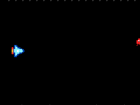
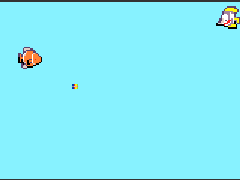
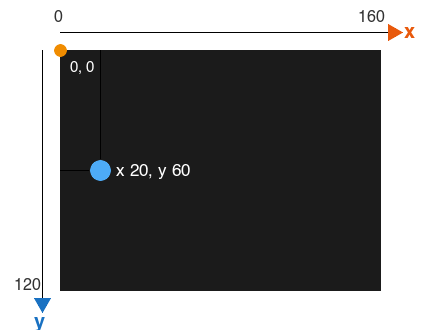

# Ton premier jeu de tir

```template
scene.setBackgroundColor(15)
```

## Ton premier jeu de tir @showdialog

Ton héros vole de haut en bas, tire, et détruit les ennemis qui foncent sur lui.





Le même jeu, deux thèmes. Tu dessines tout toi-même : ton héros, son tir, tes ennemis. Pas d'idée ? Un vaisseau spatial.

## Ton héros

Crée ton héros et dessine-le.

- :paper plane: Dans ``||sprites:Sprites||``, glisse ``||variables(sprites):définir mySprite à sprite de type Player||`` dans ``||loops(noclick):au démarrage||``.
- :mouse pointer: Clique sur la petite flèche de **mySprite**, puis sur **Renommer la variable...**, et appelle-la **heros**.
- :mouse pointer: Clique sur le carré gris et dessine ton héros.

Une **variable** est un nom qui te permet de retrouver ton héros dans les autres blocs.

Il doit regarder vers la droite : c'est de ce côté qu'il tirera.

~hint Bien dessiner en pixel art 💡

---

- Commence par la silhouette, d'une couleur sombre.
- Trois ou quatre couleurs suffisent.
- Une couleur plus claire sur le dessus donne du volume.

La **Galerie** propose des dessins tout faits. Un dessin à toi rend ton jeu unique.

hint~

```blocks
scene.setBackgroundColor(15)
// @highlight
let heros = sprites.create(img`heros`, SpriteKind.Player)
```

## À gauche de l'écran

Place ton héros à gauche de l'écran.

- :paper plane: Dans ``||sprites:Sprites||``, ajoute ``||sprites:définir la position de heros à x 20 y 60||``.



**x** se compte vers la droite, **y** vers le bas, à partir du coin en haut à gauche.

```blocks
scene.setBackgroundColor(15)
let heros = sprites.create(img`heros`, SpriteKind.Player)
// @highlight
heros.setPosition(20, 60)
```

## De haut en bas

Fais monter et descendre ton héros avec les flèches.

- :game: Dans ``||controller:Contrôleur||``, ajoute ``||controller:déplacer heros avec les boutons vx 0 vy 100||``.

**vx** vaut 0 : ton héros ne va ni à gauche ni à droite. Il ne bouge que de haut en bas.

Essaie avec les flèches du clavier : monte tout en haut. Que se passe-t-il ?

```blocks
scene.setBackgroundColor(15)
let heros = sprites.create(img`heros`, SpriteKind.Player)
heros.setPosition(20, 60)
// @highlight
controller.moveSprite(heros, 0, 100)
```

## Reste à l'écran

Ton héros sort de l'écran : garde-le dedans.

- :paper plane: Dans ``||sprites:Sprites||``, ajoute ``||sprites:définir heros rester à l'écran ON||``.

Essaie de nouveau : il s'arrête au bord.

```blocks
scene.setBackgroundColor(15)
let heros = sprites.create(img`heros`, SpriteKind.Player)
heros.setPosition(20, 60)
controller.moveSprite(heros, 0, 100)
// @highlight
heros.setStayInScreen(true)
```

## Le tir

Ton héros tire quand tu appuies sur A.

- :game: Dans ``||controller:Contrôleur||``, sors ``||controller:quand bouton A est appuyé||``.
- :paper plane: Dedans, mets ``||variables(sprites):définir tir à projectile depuis heros avec vx 150 vy 0||``.
- :mouse pointer: Clique sur le carré gris et dessine ton tir : petit, 3 ou 4 pixels de haut.

Essaie : la touche **espace** du clavier est le bouton A.

```blockconfig.local
let tir = sprites.createProjectileFromSprite(img`tir`, heros, 150, 0)
```

```blocks
// @highlight
controller.A.onEvent(ControllerButtonEvent.Pressed, function () {
    let tir = sprites.createProjectileFromSprite(img`tir`, heros, 150, 0)
})
```

## Les ennemis arrivent

Des ennemis apparaissent au bord droit de l'écran.

- :circle: Dans ``||game:Jeu||``, sors ``||game:quand mise à jour du jeu chaque 900 ms||``.
- :paper plane: Dedans, mets ``||variables(sprites):définir mySprite à sprite de type Player||``.
- :mouse pointer: Clique sur la petite flèche de **mySprite**, puis sur **Nouvelle variable...**, et appelle-la **ennemi**.
- :mouse pointer: Choisis **Enemy** à la place de **Player**, et dessine ton ennemi.
- :paper plane: Ajoute ``||sprites:définir la position de ennemi à x 160 y||``.
- :calculator: Pour **y**, prends ``||math:choisir aléatoirement entre 10 et 110||`` dans ``||math:Maths||``.

Un ennemi toutes les 900 ms, à une hauteur différente à chaque fois.

~hint Pourquoi une nouvelle variable ? 💡

---

Si l'ennemi prenait la variable **heros**, chaque nouvel ennemi prendrait la place de ton héros dans la variable : les flèches et le tir passeraient au dernier ennemi créé.

Une variable par chose que tu dois retrouver plus tard. Tous les ennemis peuvent partager **ennemi** : on ne s'en sert qu'au moment où on les crée.

hint~

```blockconfig.local
let ennemi: Sprite = null
ennemi.setPosition(160, randint(10, 110))
```

```blocks
// @highlight
game.onUpdateInterval(900, function () {
    let ennemi = sprites.create(img`ennemi`, SpriteKind.Enemy)
    ennemi.setPosition(160, randint(10, 110))
})
```

## Ils foncent sur toi

Les ennemis foncent vers ton héros.

- :paper plane: Dans le même bloc, ajoute ``||sprites:définir ennemi vx (vitesse selon x) à -40||``.
- :paper plane: Puis ``||sprites:définir ennemi destruction automatique ON||``.

La vitesse est négative : l'ennemi va vers la gauche.

~hint Pourquoi la destruction automatique ? 💡

---

Sans elle, un ennemi sorti de l'écran continue d'exister. Au bout de quelques minutes, ils sont des centaines et le jeu ralentit.

hint~

```blockconfig.local
let ennemi: Sprite = null
ennemi.vx = -40
ennemi.setFlag(SpriteFlag.AutoDestroy, true)
```

```blocks
game.onUpdateInterval(900, function () {
    let ennemi = sprites.create(img`ennemi`, SpriteKind.Enemy)
    ennemi.setPosition(160, randint(10, 110))
    // @highlight
    ennemi.vx = -40
    // @highlight
    ennemi.setFlag(SpriteFlag.AutoDestroy, true)
})
```

## Touché !

Un ennemi touché par ton tir explose.

- :paper plane: Dans ``||sprites:Sprites||``, sors ``||sprites:quand sprite de type Projectile chevauche otherSprite de type Enemy||``.
- :paper plane: Dedans, mets ``||sprites:détruire sprite||`` : **sprite** est le tir, il disparaît.
- :paper plane: Ajoute un second ``||sprites:détruire sprite||``, et clique sur son **+** : choisis l'effet **feu**, pendant **200** ms.
- :mouse pointer: Glisse le **otherSprite** rouge, en haut du bloc **quand**, à la place de **sprite** dans ce second **détruire** : **otherSprite** est l'ennemi touché, il explose.

```blockconfig.local
sprites.onOverlap(SpriteKind.Projectile, SpriteKind.Enemy, function (sprite, otherSprite) {
})
sprites.destroy(sprite)
```

```blocks
// @highlight
sprites.onOverlap(SpriteKind.Projectile, SpriteKind.Enemy, function (sprite, otherSprite) {
    sprites.destroy(sprite)
    sprites.destroy(otherSprite, effects.fire, 200)
})
```

## Le temps du pixel art

Ton jeu marche. Prends maintenant le temps de soigner tes dessins.

- :mouse pointer: Clique sur chaque dessin pour le retoucher : ton héros, son tir, ton ennemi.
- :mouse pointer: Change la couleur du fond dans ``||scene(noclick):définir couleur d'arrière-plan||``.

Teste après chaque retouche : un ennemi trop sombre sur un fond sombre ne se voit plus.

## Bravo @showdialog

Ton premier jeu de tir marche. Clique sur **Terminé**, puis, en haut de l'écran, sur **Partager** : donne un nom à ton jeu et copie son lien. Pas besoin de compte. Ce lien te permet de rouvrir ton jeu sur n'importe quel ordinateur.

```blockconfig.global
let heros: Sprite = null
heros.setPosition(20, 60)
controller.moveSprite(heros, 0, 100)
heros.setStayInScreen(true)
let tir = sprites.createProjectileFromSprite(img`tir`, heros, 150, 0)
```
