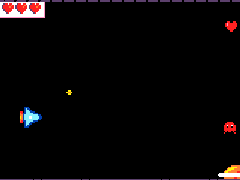

# Finis ton jeu

```template
scene.setBackgroundColor(15)
let heros = sprites.create(img`heros`, SpriteKind.Player)
heros.setPosition(20, 60)
controller.moveSprite(heros, 0, 100)
heros.setStayInScreen(true)
controller.A.onEvent(ControllerButtonEvent.Pressed, function () {
    let tir = sprites.createProjectileFromSprite(img`tir`, heros, 150, 0)
})
game.onUpdateInterval(900, function () {
    let ennemi = sprites.create(img`ennemi`, SpriteKind.Enemy)
    ennemi.setPosition(160, randint(10, 110))
    ennemi.vx = -40
    ennemi.setFlag(SpriteFlag.AutoDestroy, true)
})
sprites.onOverlap(SpriteKind.Projectile, SpriteKind.Enemy, function (sprite, otherSprite) {
    sprites.destroy(sprite)
    sprites.destroy(otherSprite, effects.fire, 200)
})
```

## Finis ton jeu @showdialog

Ton jeu reprend là où tu l'as laissé. Aujourd'hui : un écran de démarrage, un score, des vies, et un décor qui défile derrière ton héros.



## L'écran de démarrage

- :circle: Dans ``||game:Jeu||``, prends ``||game:splash||`` et place-le tout en haut de ``||loops(noclick):au démarrage||``.
- :mouse pointer: Écris le titre de ton jeu, puis **Appuie sur A pour jouer**.

Le jeu attend que le joueur appuie sur A pour commencer.

```blocks
// @highlight
game.splash("Mon jeu de tir", "Appuie sur A pour jouer")
scene.setBackgroundColor(15)
let heros = sprites.create(img`heros`, SpriteKind.Player)
heros.setPosition(20, 60)
controller.moveSprite(heros, 0, 100)
heros.setStayInScreen(true)
info.setLife(3)
```

## Le score

- :id card: Dans ``||info:Info||``, prends ``||info:modifier le score de 1||`` et place-le dans le bloc **quand sprite de type Projectile chevauche otherSprite de type Enemy**, sous les deux **détruire**.

Chaque ennemi détruit rapporte un point. Le score s'affiche en haut à droite.

```blocks
sprites.onOverlap(SpriteKind.Projectile, SpriteKind.Enemy, function (sprite, otherSprite) {
    sprites.destroy(sprite)
    sprites.destroy(otherSprite, effects.fire, 200)
    // @highlight
    info.changeScoreBy(1)
})
```

## Les vies

- :id card: Dans ``||info:Info||``, ajoute ``||info:définir vie à 3||`` à la fin de ``||loops(noclick):au démarrage||``.

Les vies s'affichent en haut à gauche.

```blocks
game.splash("Mon jeu de tir", "Appuie sur A pour jouer")
scene.setBackgroundColor(15)
let heros = sprites.create(img`heros`, SpriteKind.Player)
heros.setPosition(20, 60)
controller.moveSprite(heros, 0, 100)
heros.setStayInScreen(true)
// @highlight
info.setLife(3)
```

## Aïe !

- :paper plane: Dans ``||sprites:Sprites||``, sors ``||sprites:quand sprite de type Player chevauche otherSprite de type Enemy||``.
- :paper plane: Dedans, mets ``||sprites:détruire sprite||``, et glisse le **otherSprite** rouge à la place de **sprite** : l'ennemi qui t'a touché disparaît.
- :id card: Ajoute ``||info:modifier la vie de -1||``.
- :tree: Dans ``||scene:Scène||``, ajoute ``||scene:secouer la caméra de 4 pixels durant 500 ms||``.

Laisse-toi toucher trois fois : à 0 vie, la partie s'arrête toute seule.

```blockconfig.local
sprites.onOverlap(SpriteKind.Player, SpriteKind.Enemy, function (sprite, otherSprite) {
})
info.changeLifeBy(-1)
scene.cameraShake(4, 500)
```

```blocks
// @highlight
sprites.onOverlap(SpriteKind.Player, SpriteKind.Enemy, function (sprite, otherSprite) {
    // @highlight
    sprites.destroy(otherSprite)
    // @highlight
    info.changeLifeBy(-1)
    // @highlight
    scene.cameraShake(4, 500)
})
```

## Le décor

Des planètes, des nuages ou des étoiles vont défiler derrière ton héros.

- :circle: Dans ``||game:Jeu||``, sors ``||game:quand mise à jour du jeu chaque 3000 ms||``.
- :paper plane: Dedans, mets ``||variables(sprites):définir mySprite à sprite de type Player||``, puis **Nouvelle variable...** dans son menu, et appelle-la **decor**.
- :mouse pointer: Dessine un élément de ton décor : une planète, un nuage, une étoile.
- :paper plane: Ajoute ``||sprites:définir la position de decor à x 160 y||`` avec ``||math:choisir aléatoirement entre 0 et 120||``.
- :paper plane: Ajoute ``||sprites:définir decor vx (vitesse selon x) à -15||``.

Le décor va moins vite que les ennemis : il paraît plus loin.

```blockconfig.local
let decor: Sprite = null
decor.setPosition(160, randint(0, 120))
decor.vx = -15
```

```blocks
// @highlight
game.onUpdateInterval(3000, function () {
    let decor = sprites.create(img`decor`, SpriteKind.Player)
    decor.setPosition(160, randint(0, 120))
    decor.vx = -15
})
```

## Derrière, et sans toucher

Pour l'instant, ton décor passe devant ton héros, et il peut le toucher comme un ennemi.

- :paper plane: Dans le même bloc, ajoute ``||sprites:définir decor z (profondeur) à -1||`` : le décor passe derrière.
- :paper plane: Ajoute ``||sprites:définir decor fantôme ON||`` : le décor ne touche plus rien.
- :paper plane: Ajoute un second ``||sprites:définir decor fantôme ON||``, et choisis **destruction automatique** dans son menu.

~hint Profondeur et fantôme 💡

---

Les sprites ont tous une profondeur **z** de 0. Celui qui a la plus petite est dessiné en dessous.

Un sprite **fantôme** ne déclenche aucun bloc **chevauche** : ni tes tirs, ni ton héros ne réagissent à ton décor.

hint~

```blockconfig.local
let decor: Sprite = null
decor.z = -1
decor.setFlag(SpriteFlag.Ghost, true)
decor.setFlag(SpriteFlag.AutoDestroy, true)
```

```blocks
game.onUpdateInterval(3000, function () {
    let decor = sprites.create(img`decor`, SpriteKind.Player)
    decor.setPosition(160, randint(0, 120))
    decor.vx = -15
    // @highlight
    decor.z = -1
    // @highlight
    decor.setFlag(SpriteFlag.Ghost, true)
    // @highlight
    decor.setFlag(SpriteFlag.AutoDestroy, true)
})
```

## Le temps du pixel art

Ton jeu est complet. Prends le temps de soigner ton décor.

- :mouse pointer: Retouche ton élément de décor, et change la couleur du fond si besoin.
- :mouse pointer: Vérifie que tes ennemis se voient bien devant le décor.

## Bravo @showdialog

Ton jeu est complet. Clique sur **Terminé**, puis sur **Partager** : copie le nouveau lien de ton jeu.

```blockconfig.global
let heros: Sprite = null
heros.setPosition(20, 60)
controller.moveSprite(heros, 0, 100)
heros.setStayInScreen(true)
let tir = sprites.createProjectileFromSprite(img`tir`, heros, 150, 0)
```
